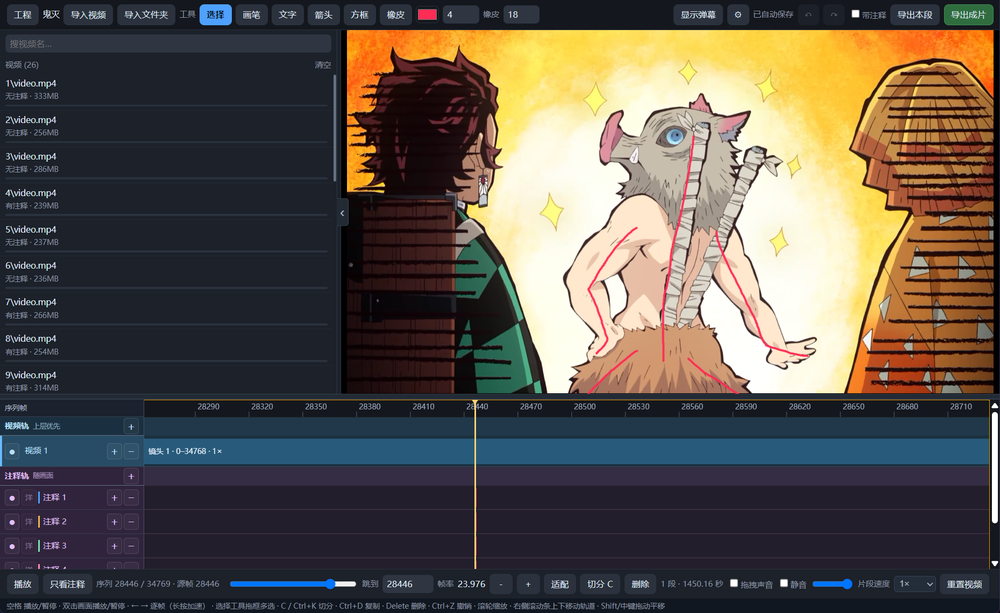

# InkCut 拉片与标注

InkCut 是 Windows 桌面拉片工具。一次专注一条源视频：逐帧看片、画构图线、给动作写注释，再用多轨时间轴裁剪和调整片段速度。剪辑和注释都不会改写原视频。

[**下载 Windows x64 便携版（ZIP）**](https://github.com/leonleeyaung/InkCut/releases/download/v0.6.0/InkCut-0.6.0-Windows-x64.zip) · [版本说明与 SHA-256 校验文件](https://github.com/leonleeyaung/InkCut/releases/tag/v0.6.0)



## 下载即用（Windows x64）

下载上面的便携版 ZIP，**完整解压**到一个可写目录，再双击 **`启动InkCut.cmd`**。包内自带 Electron 和 FFmpeg，不用另装 Node.js、Python 或 FFmpeg，首次启动也不需要下载组件。请勿直接在压缩包内运行。GitHub 自动生成的 `Source code (zip)` 是源码包，不是便携版。

## 从源码启动（可选）

1. 在 GitHub 仓库点 **Code → Download ZIP**，把 ZIP **完整解压**到一个有写入权限的目录。也可以用 Git 克隆本仓库。
2. 普通用户不需要 Node.js 或 Python。先安装 [FFmpeg](https://ffmpeg.org/download.html) 的 Windows 版本。如果你下载的是压缩包，取其中的 `bin\ffmpeg.exe`，放到 InkCut 目录下的 `tools\ffmpeg.exe`（没有 `tools` 就新建）。已经把 FFmpeg 加入系统 `PATH` 的可以跳过复制。
3. 双击 **`启动InkCut.cmd`**。第一次启动会从 Electron 官方 GitHub 下载约 151 MiB 的 Windows x64 运行包，校验 SHA-256 后自动解压。请等到出现工程窗口。以后双击同一个文件即可，日常剪辑可离线使用。

如果自动下载失败，可在浏览器打开 [Electron v45.3.2 官方发行页](https://github.com/electron/electron/releases/tag/v45.3.2)，下载 `electron-v45.3.2-win32-x64.zip`。用 `Get-FileHash` 核对 SHA-256：`cd1ab0d49c2f76838c0c9ff75afefb4d9d85ca59036691932bf35be8eceba98b`，再完整解压到项目的 `runtime` 文件夹，确认 `runtime\electron.exe` 存在，重新双击启动。不要只复制一个 exe。

开发者也可以安装 [Node.js](https://nodejs.org/)（22.12.0 或以上，含 npm），在项目目录执行：

```powershell
npm.cmd ci
npm.cmd run doctor
npm.cmd start
```

`doctor` 应显示 FFmpeg 和 Electron 的版本。若提示找不到 FFmpeg，请确认放的是 `tools\ffmpeg.exe`，不是整个压缩包；如果刚修改了 PATH，请重新打开终端。也可以把环境变量 `INKCUT_FFMPEG` 设为现有 `ffmpeg.exe` 的完整路径。仓库不包含 Electron、FFmpeg、视频素材或在线服务密钥。

## 第一次拉片

1. 点 **新建工程**，选好保存位置，再把视频或整个文件夹拖进窗口。视频列表按数字顺序排列，切换列表项就能切换源视频。
2. 按 **空格**播放或暂停；用 **← / →** 逐帧检查，长按会加速。鼠标停在画面上滚轮缩放，点击右下角百分比恢复适应窗口。
3. 在目标帧选画笔、文字、箭头或方框，在预览里标注。新注释默认持续一帧；拖动紫色注释块的右边缘，让它延续到动作结束。需要同一时刻的多条注释时，软件会自动分轨。
4. 要导出剪好的视频，选择导出本段或整段；希望成片保留画面注释时，勾选 **带注释**。只会合成可见注释，不会带上选择框、洋葱皮或在线弹幕。

## 剪辑与注释操作

| 想做什么 | 操作 |
| --- | --- |
| 切分、裁剪或变速 | `C` 或 `Ctrl+K` 在播放头处切分；拖片段边缘裁剪；选中片段在「片段速度」设为 0.25×～4×，预览与导出都生效。 |
| 调整轨道 | 用轨道左侧的 `＋` / `−` 增删。视频轨重叠时显示上层；同轨拖动片段会覆盖重叠部分。时间轴滚轮缩放，`Shift` 或中键拖动平移。 |
| 批量修改注释**时间** | 从紫色注释轨空白处拖框，可跨轨选中多条。拖选中项的左边缘统一调整开始时间，右边缘调整结束时间，最短保留一帧。`Alt` 拖动临时关闭吸附。 |
| 批量修改注释**位置** | 按 `V` 切换到选择工具，从**画面**空白处拖框，再拖选中的任一注释，整组一起移动。「只看注释」可暂时隐藏底图和弹幕。 |
| 还原操作 | `Ctrl+Z` 撤销，`Ctrl+Y` 重做。「重置视频」还原完整源视频、单轨和 1 倍速，保留注释。 |

## 保存、移动与备份

工程文件记录视频列表和路径；**每个源视频旁边的同名 `.inkcut.json` 才保存该视频的剪辑和注释**。例如 `镜头01.mp4` 对应 `镜头01.inkcut.json`。修改会自动保存，也可按 `Ctrl+S`。请给素材目录保留写权限。换电脑时要一并备份工程文件、源视频和旁边的 JSON；如果路径变了，在视频列表里重新定位失联素材。

## 弹幕（可选）

点右上角齿轮，粘贴 B 站番剧或视频完整链接，读取并确认集数；开启「记住此文件夹」后可匹配同季的其他集。在线来源不可用时可导入 B 站 XML、弹弹play JSON，或用已有缓存。弹弹play 在线接口需要用户自己的有效应用凭证；不是安装或使用剪辑功能的前提。

## 开发

应用入口为 `desktop.cjs`，窗口加载仓库内已生成的 `index.html` 和 `app.js`。**普通用户不用安装 Python。** 修改界面时，编辑 `*.part.js`、`danmaku.html` 或 `build-renderer.py`，再用 Python 3 运行 `python build-renderer.py`；基础模板位于 `renderer/base.html`。`npm.cmd test` 运行使用模拟响应的弹幕服务测试，不需要真实凭证。
